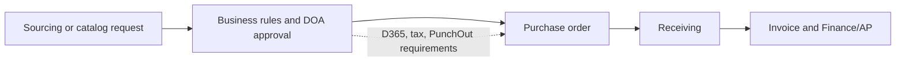

# LATAM Spend Management Workflows — FARFETCH

**Role:** Procurement Lead, LATAM  
**Period:** April 2021–April 2023  
**Focus:** Enterprise workflow design, regional implementation, approvals, finance integrations, and adoption

## Context

FARFETCH's LATAM Coupa implementation connected procurement activity with Finance and ERP processes in Brazil and Mexico. The scope crossed sourcing, purchasing, approvals, receiving, tax, and accounts payable.

## The product challenge

Regional teams needed end-to-end workflows that reflected local business rules while supporting shared controls and connected systems. A requirement at one step—such as approval authority or tax treatment—could affect downstream purchase orders, receiving, and invoice processing.

## My contribution

As Procurement Lead for LATAM, I coordinated business requirements and supported implementation across Brazil and Mexico. I worked across Procurement, Finance/AP, Compliance, and technical and functional partners to clarify business rules, map approval flows, and align process needs with the platform and connected systems.

The documented scope included:

- Sourcing and purchase requests
- Delegation of Authority (DOA) approvals
- Purchase orders, receiving, and invoices
- Coupa and Microsoft Dynamics 365 (D365) ERP processes
- Tax and Finance/AP requirements
- Amazon PunchOut catalog connectivity

My contribution was business and product-facing: requirements, workflow alignment, stakeholder coordination, and implementation support. I did not personally engineer the integrations or configure the platform.

## Simplified business flow

This is a high-level business view, not a system architecture diagram.

## How I approached it

1. **Clarified regional requirements:** captured Brazil and Mexico needs across procurement, finance, tax, and compliance.
2. **Connected the workflow end to end:** considered how sourcing, approvals, POs, receiving, and invoices depended on one another.
3. **Aligned business rules and integrations:** coordinated DOA, D365, tax, Finance/AP, and Amazon PunchOut requirements with implementation partners.
4. **Supported rollout and adoption:** helped regional users and stakeholders work through standardized platform processes.

## Outcome and evidence

The work supported a connected LATAM spend-management implementation across procurement and finance workflows. The evidence confirms scope and implementation responsibilities but does not provide a defensible time-savings, cost-savings, or adoption metric, so none is claimed here.

## My takeaway

In enterprise workflow products, the handoffs matter as much as each individual screen. Surfacing approval, tax, ERP, receiving, and invoice dependencies early helps teams define a process that can work from request through payment.

## What this demonstrates

- Enterprise product and business-systems work
- Requirements across functions and markets
- Workflow and approval design
- Integration planning across procurement and finance
- Cross-functional implementation leadership

## Evidence note

This public summary is based on my documented experience. The workflow view is a simplified reconstruction; it does not reproduce FARFETCH configuration, internal process maps, or proprietary technical details.
